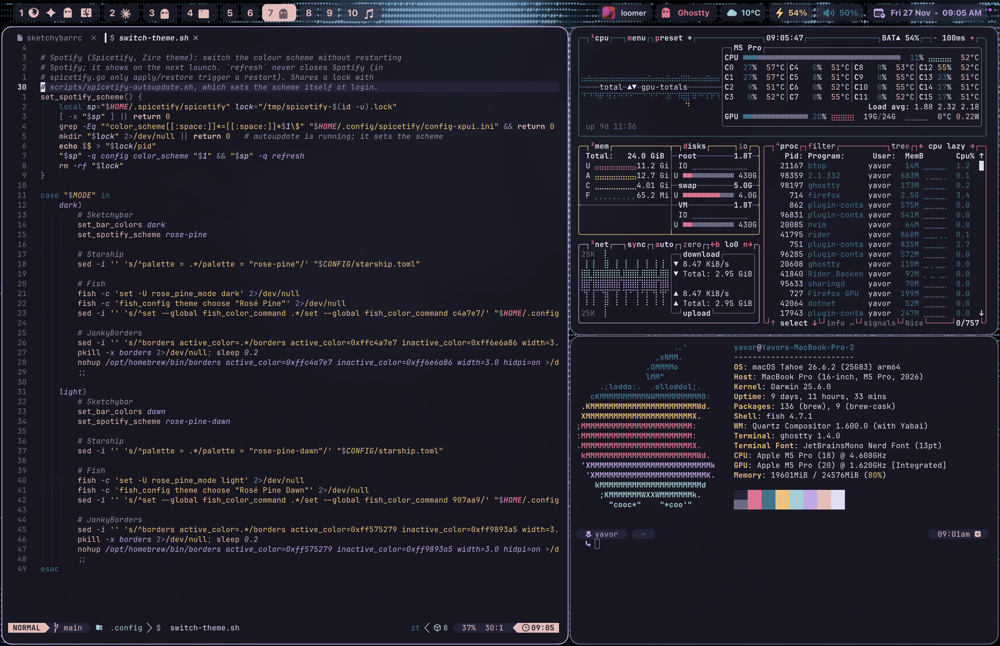
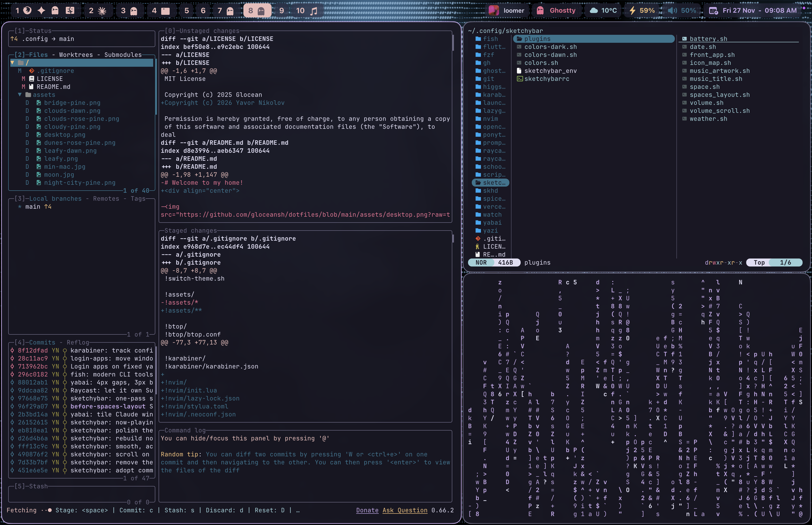
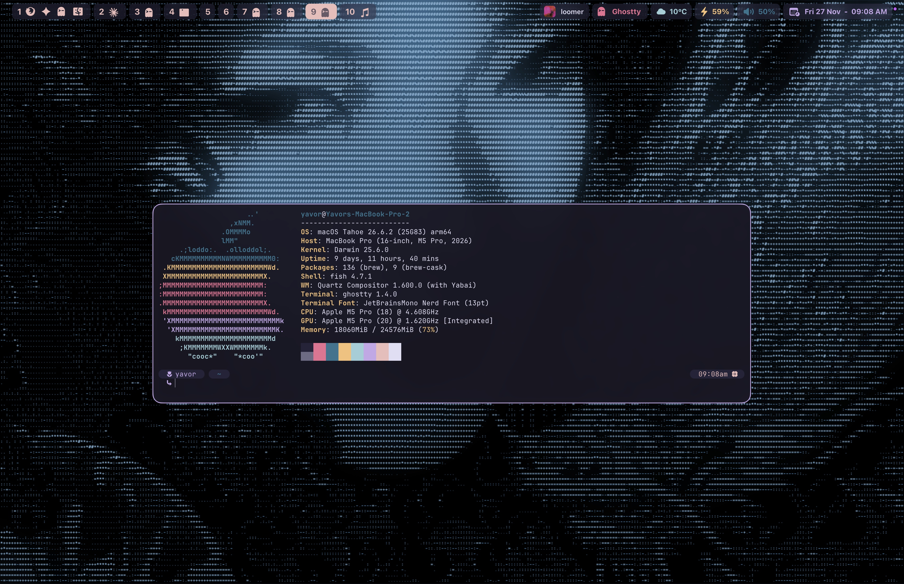

<div align="center">

# 🌙 dotfiles · yabai + Rosé Pine

**A keyboard-driven tiling setup for macOS Tahoe that feels like Hyprland or i3.**
One Rosé Pine palette everywhere: bar, borders, terminal, prompt, editor, file manager and Spotify.

[](https://www.apple.com/os/macos/)
[](https://github.com/asmvik/yabai)
[](https://rosepinetheme.com/)
[](https://github.com/YYN192/dotfiles/commits/main)
[](LICENSE)

<a href="#-gallery">🖼️ Gallery</a> ·
<a href="#-whats-inside">🧩 What's inside</a> ·
<a href="#-install">🚀 Install</a> ·
<a href="#%EF%B8%8F-keybindings">⌨️ Keybindings</a> ·
<a href="#-layout">🗂️ Layout</a> ·
<a href="#-credits">🙏 Credits</a>



</div>

## 🖼️ Gallery

| Tools | Clean |
| --- | --- |
|  |  |

## 🧩 What's inside

| | |
| --- | --- |
| **Window manager** | [yabai](https://github.com/asmvik/yabai) (bsp, 4 px gaps) + [JankyBorders](https://github.com/FelixKratz/JankyBorders) |
| **Hotkeys** | [skhd](https://github.com/koekeishiya/skhd) + [Karabiner-Elements](https://karabiner-elements.pqrs.org/) (Caps Lock → Super) |
| **Bar** | [SketchyBar](https://github.com/FelixKratz/SketchyBar), drawn around the notch |
| **Terminal** | [Ghostty](https://ghostty.org/) with blur, [fish](https://fishshell.com/) and [Starship](https://starship.rs/) |
| **Editor** | [Neovim](https://neovim.io/) with [LazyVim](https://www.lazyvim.org/) and [rose-pine/neovim](https://github.com/rose-pine/neovim) |
| **CLI** | eza, bat, fzf, zoxide, ripgrep, fd, [yazi](https://yazi-rs.github.io/), lazygit, lazydocker, atuin, btop, fastfetch |
| **Launcher** | [Raycast](https://www.raycast.com/) |
| **Spotify** | [Spicetify](https://spicetify.app/) + Ziro theme |
| **Fonts** | SF Pro, JetBrains Mono Nerd Font, sketchybar-app-font, SF Symbols |

### Highlights

- **🌗 Automatic theme switching.** [dark-notify](https://github.com/cormacrelf/dark-notify) runs [`switch-theme.sh`](switch-theme.sh) when macOS changes appearance. It recolours SketchyBar, JankyBorders, Starship, fish, Spotify, and bat/eza/fzf/lazygit in open shells. Ghostty and yazi follow by themselves, and Neovim picks its variant when it starts. Dark mode is the main look.
- **🧭 A bar built around the notch.** All 10 workspaces always show. Empty ones show only a number. Unfocused ones drop their app icons until the left side clears the notch ([`spaces_layout.sh`](sketchybar/plugins/spaces_layout.sh)).
- **🎵 Now playing, weather, battery, volume** pills. Scroll on the volume pill to change the volume smoothly.
- **⌨️ One Super key.** Tap Caps Lock for Esc. Hold it for Super (⌘⌥⌃). Hold ⌘ and tap Caps to switch keyboard language (U.S. ↔ Bulgarian Phonetic; edit [`karabiner.json`](karabiner/karabiner.json) for your own pair).
- **🪟 Hyprland-style keys.** Super + Return opens a terminal, Super + C closes a window, and Super + / opens a searchable keymap cheatsheet in Raycast.
- **🧹 Quit on last window.** Closing an app's last window quits the app ([`quit-on-last-window.sh`](yabai/quit-on-last-window.sh)).
- **🚪 Login layout** (optional). [`login-apps.sh`](scripts/login-apps.sh) opens your apps on fixed workspaces at login.

## 🚀 Install

> [!WARNING]
> This repo **is** `~/.config`. Back up your current `~/.config` before cloning.

```bash
git clone https://github.com/YYN192/dotfiles.git ~/.config
bash ~/.config/setup.sh
```

[`setup.sh`](setup.sh) installs everything with Homebrew (taps, formulae, casks, fonts). It also:

- makes fish your login shell and installs the fisher plugins
- sets up the yabai scripting-addition sudoers entry
- loads the dark-notify LaunchAgent for automatic theme switching
- installs Spicetify with its auto-update agent

Then:

```bash
yabai --start-service
skhd --start-service
brew services start sketchybar
```

### After installing

1. **SIP:** yabai's scripting addition needs SIP partly disabled. See the [yabai wiki](https://github.com/asmvik/yabai/wiki/Disabling-System-Integrity-Protection). After every `brew upgrade yabai`, re-run the sudoers block in `setup.sh`.
2. **Karabiner-Elements:** open it once and grant its permissions. It reads [`karabiner/karabiner.json`](karabiner/karabiner.json) directly.
3. **Weather:** get a free [OpenWeather](https://home.openweathermap.org/api_keys) key (it can take ~30 min to activate) and put it in `~/.config/sketchybar/sketchybar_env`:
   ```bash
   export API_KEY="your_api_key_here"
   ```
4. **Neovim:** run `nvim` once. LazyVim installs its plugins on first launch.
5. **Keymap cheatsheet:** in Raycast, go to Extensions → Add Script Directory and pick `~/.config/raycast-scripts`.
6. **Your own stuff:** machine-specific paths and aliases go in `~/.config/fish/conf.d/local.fish`. Git ignores that file.

## ⌨️ Keybindings

`Super` = Caps Lock held (⌘⌥⌃). Every binding is in [`skhd/skhdrc`](skhd/skhdrc); press **Super + /** for a searchable list.

| Keys | Action |
| --- | --- |
| `Super + Return` | New Ghostty window |
| `Super + C` | Close window |
| `Super + H/J/K/L` | Focus left / down / up / right |
| `Super + Shift + H/J/K/L` | Move window left / down / up / right |
| `Super + 1…0` | Go to workspace 1…10 |
| `Super + Shift + 1…0` | Send window to workspace 1…10 and follow it |
| `Super + U/I/O/P` | Resize |
| `Super + E` | Balance window sizes |
| `Super + R` / `Super + Shift + R` | Rotate layout |
| `Super + X` / `Super + Shift + X` | Mirror on the y / x axis |
| `Super + F` / `Super + Shift + F` | Zoom fullscreen / native fullscreen |
| `Super + V` or `Super + Space` | Float and centre window |
| `Super + Q/W` (`+ Shift`) | Focus monitor 1/2 (move window there) |
| `Super + /` | Keymap cheatsheet (Raycast) |
| `Caps Lock` (tap) | Esc |
| `⌘ + Caps Lock` (tap) | Switch keyboard language |

## 🗂️ Layout

```
~/.config
├── setup.sh             one-shot installer
├── switch-theme.sh      dark/light switcher, called by dark-notify
├── yabai/               tiling rules, gaps, borders, quit-on-last-window
├── skhd/skhdrc          every keybinding
├── karabiner/           Caps Lock → Super/Esc, ⌘+Caps → language
├── sketchybar/          bar config, Rosé Pine palettes, plugins/
├── ghostty/config       terminal
├── fish/                shell, fisher plugins, conf.d/cli-tools.fish
├── starship.toml        prompt
├── nvim/                LazyVim + Rosé Pine
├── yazi/ lazygit/ bat/ eza/ fzf/ btop/ atuin/   tool configs + Rosé Pine themes
├── raycast-scripts/     keymap cheatsheet
├── scripts/ launchd/    login apps, Spicetify auto-update + their LaunchAgents
└── assets/screenshots/  the images above
```

The repo only tracks what it lists in [`.gitignore`](.gitignore): `*` ignores everything, then `!path` lines allow each file. Other apps' files in `~/.config` stay out of git.

## 🙏 Credits

- Forked from [**gloceandotdev/dotfiles**](https://github.com/gloceandotdev/dotfiles) by Glocean, the base of this rice. Their Rosé Pine wallpaper pack lives there too.
- [Rosé Pine](https://rosepinetheme.com/) and all its ports.
- Now-playing widget adapted from [Kcraft059/sketchybar-config](https://github.com/Kcraft059/sketchybar-config).
- [FelixKratz](https://github.com/FelixKratz) for SketchyBar and JankyBorders, [asmvik](https://github.com/asmvik) and [koekeishiya](https://github.com/koekeishiya) for yabai and skhd.
- [LazyVim](https://github.com/LazyVim/starter) starter (Apache-2.0, see [`nvim/LICENSE`](nvim/LICENSE)).

## 📄 License

[MIT](LICENSE).
